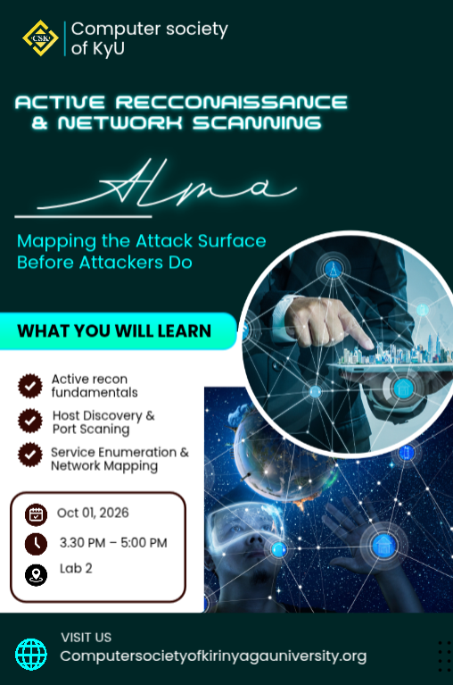

<div align="center">

# Active Reconnaissance & Network Scanning

### Mapping the attack surface before attackers do.

`sudo nmap -sS -sV 192.168.56.20`

[](./LICENSE)
[](https://nmap.org)


**22 slides · PDF + editable PowerPoint**

[Download the deck (PDF)](./Active_Recon_Nmap.pdf) · [Get the slides (PPTX)](./Active_Recon_Nmap.pptx)



</div>

---

## About

A hands-on training deck on **active reconnaissance** — the practice of probing systems you are authorized to test to discover live hosts, open ports, running services, and software versions.

The deck walks from the fundamentals of IP addressing and the TCP/UDP distinction all the way through practical Nmap workflows: host discovery, TCP and UDP scanning, service fingerprinting, OS detection, and the Nmap Scripting Engine. It closes with web, DNS, and SMB enumeration plus the reporting discipline that turns raw scan output into a defensible findings write-up.

The central idea: **an open port is not a vulnerability.** This material is about building an accurate, evidence-backed picture of exposure — the same picture an attacker builds, so a defender can get there first.

---

## Learning objectives

By the end of this session, participants can:

| # | Objective |
|---|-----------|
| 1 | Explain active reconnaissance and understand its legal limits |
| 2 | Find live hosts on an authorized network |
| 3 | Scan open TCP and UDP ports |
| 4 | Detect services and software versions |
| 5 | Perform basic service enumeration |
| 6 | Read Nmap output and interpret port states correctly |
| 7 | Save scan evidence and write a findings report |

---

## What the deck covers

### Foundations
- **Passive vs. active reconnaissance** — when to use each, and how each is detected
- **Rules of engagement** — authorization, scope, timing, and rate limits before a single packet is sent
- **Networking basics** — IP addressing, private ranges, and the ports defenders care about most
- **TCP vs. UDP** — handshake behavior and why UDP is harder to scan reliably
- **Port states** — `open`, `closed`, `filtered`, `unfiltered`, and the combined states

### Nmap in practice
- **Host discovery** — ping sweeps, ARP (`-PR`), TCP SYN probes (`-PS`), and skipping discovery (`-Pn`)
- **TCP scanning** — SYN scans, full-connect scans, port ranges, and full sweeps
- **Service and version detection** — `-sV` and reading the `PORT / STATE / SERVICE / VERSION` table
- **OS detection and aggressive mode** — `-O`, `--traceroute`, and why `-A` is used deliberately
- **UDP scanning** — why it is slower, what `open|filtered` means, and how to confirm results
- **Output formats** — `-oN`, `-oX`, `-oG`, `-oA` and why raw output is evidence
- **NSE** — `-sC` and targeted scripts for HTTP, SSL, SMB, and FTP

### Enumeration
- **Web services** — `whatweb`, `curl`, and headers/methods/scripts
- **DNS** — record types, `dig`, and the risk of an open zone transfer
- **SMB** — shares, users, groups, and policy via `smbclient` and `enum4linux-ng`
- **SSH, FTP, and RDP** — version checks and the exposures worth reporting

### Practice and reporting
- **Lab setup** — safe, isolated environments for repeatable testing
- **Scan speed and impact** — `-T3` vs. `-T4`, and where extra caution is mandatory
- **Key takeaways** — evidence, validation, and reporting

---

## Lab environment

All commands in the deck assume an isolated lab. Use one of:

- Your own Kali Linux with a local VM
- Metasploitable, OWASP BWA, or DVWA on an isolated network
- TryHackMe or Hack The Box Academy
- A university lab range
- A Docker-based vulnerable-app lab

| Role | Address |
|------|---------|
| Kali attacker VM | `192.168.56.10` |
| Target (intentionally vulnerable) | `192.168.56.20` |
| Network mode | Host-only / Internal |
| Internet exposure | Disabled |

> **Never** point these commands at random public IP addresses. Scanning without
> written permission can be unlawful.

---

## Quick reference

```bash
# Host discovery — who is alive?
sudo nmap -sn 192.168.56.0/24
sudo nmap -sn -PR 192.168.56.0/24              # ARP, local L2 only

# TCP port scanning
sudo nmap -sS 192.168.56.20                    # SYN scan (needs root)
nmap -sT 192.168.56.20                         # full connect, no root
sudo nmap -p 21,22,80,443,445,3389 192.168.56.20
sudo nmap -p- 192.168.56.20                    # all 65,535 ports

# Service and version detection
sudo nmap -sS -sV 192.168.56.20

# UDP
sudo nmap -sU --top-ports 20 192.168.56.20
sudo nmap -sU -p 53,69,123,161,500 192.168.56.20

# Save evidence (all formats, one base name)
sudo nmap -sS -sV -oA recon_scan 192.168.56.20

# Scripting engine
sudo nmap -sV -sC 192.168.56.20
nmap --script http-title,http-headers -p 80,443 192.168.56.20
```

### Sample output

```
PORT    STATE SERVICE VERSION
21/tcp  open  ftp     vsftpd 2.3.4
22/tcp  open  ssh     OpenSSH 8.2p1
80/tcp  open  http    Apache 2.4.41
```

A version string is a **lead, not proof of a flaw.** Validate before reporting.

---

## Intended audience

- Security engineers and SOC analysts
- Penetration testers and red teamers
- Blue-team defenders
- Students and researchers learning reconnaissance responsibly

---

## Ethics and authorization

> **All techniques in this deck must be used only with explicit written
> authorization, against systems you have been formally permitted to test.**

The deck is a reference for understanding exposure and threat surface. It is
not a playbook for unauthorized access. If a target is not listed in your
signed scope, it is out of scope.

Remember that a scan is observable: firewalls, IDS/IPS, and target systems all
log it. Coordinate rate limits, testing windows, and an emergency contact
before you begin.

---

## Files

| File | Description |
|------|-------------|
| `Active_Recon_Nmap.pdf` | Read-only deck for distribution and printing |
| `Active_Recon_Nmap.pptx` | Editable source for instructors and contributors |
| `Active-recon.png` | Cover artwork |

---

## Related

- [OSINT for Hackers](https://github.com/Almavj/OSINT-for-hackers-presentation) — passive collection, attack-surface mapping, and investigator tradecraft. A natural companion to this deck: OSINT shows you a host *may* exist; active recon confirms it is reachable today.

---

## License

Educational use. See [LICENSE](./LICENSE) for details.

<sub>Built for security training and defensive awareness.</sub>
